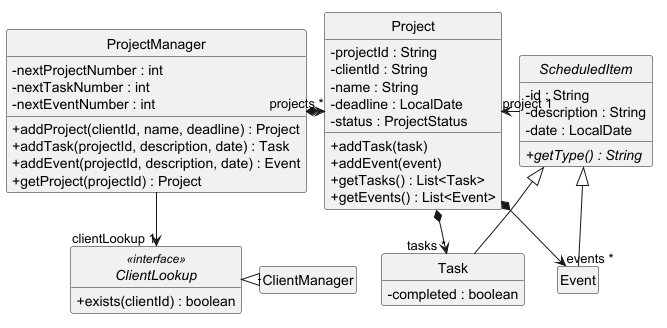
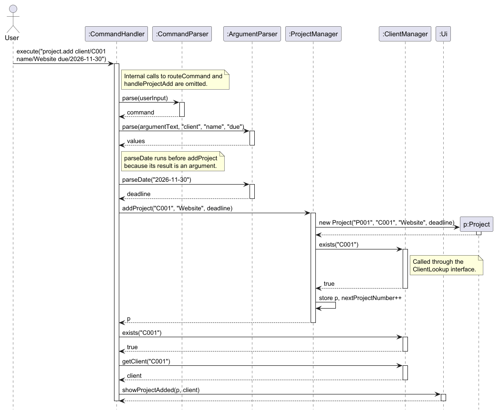
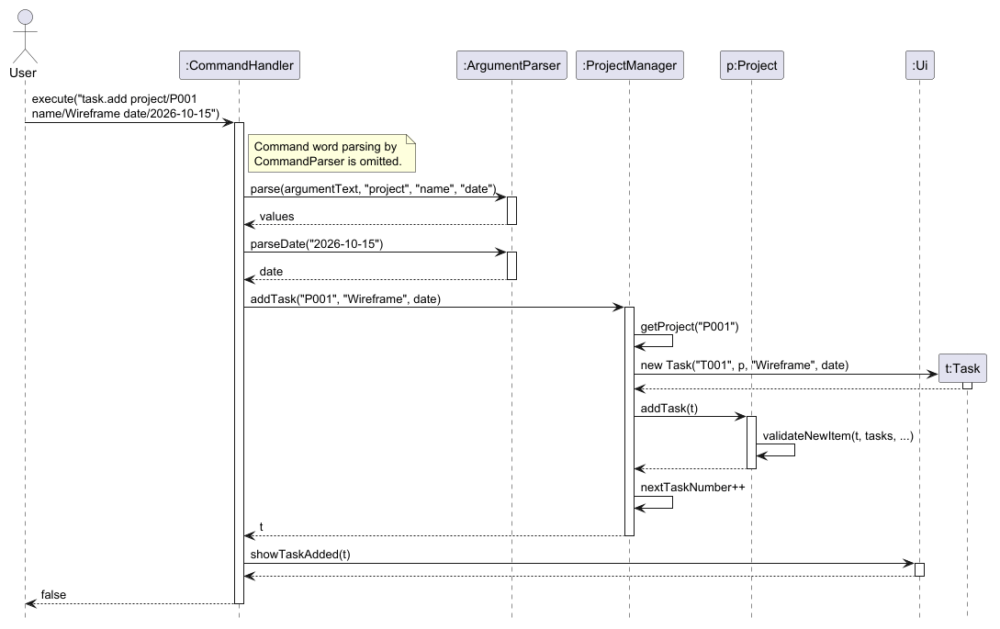
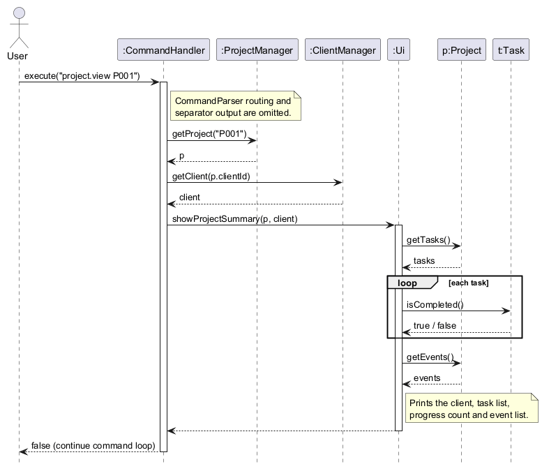
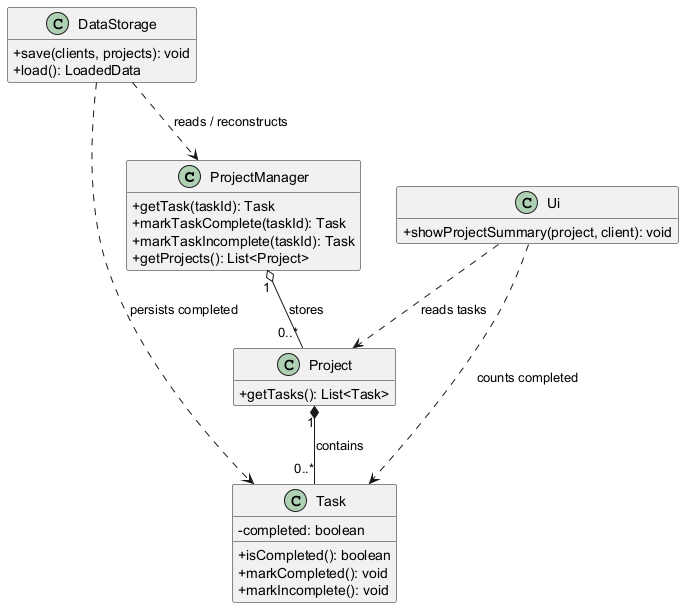
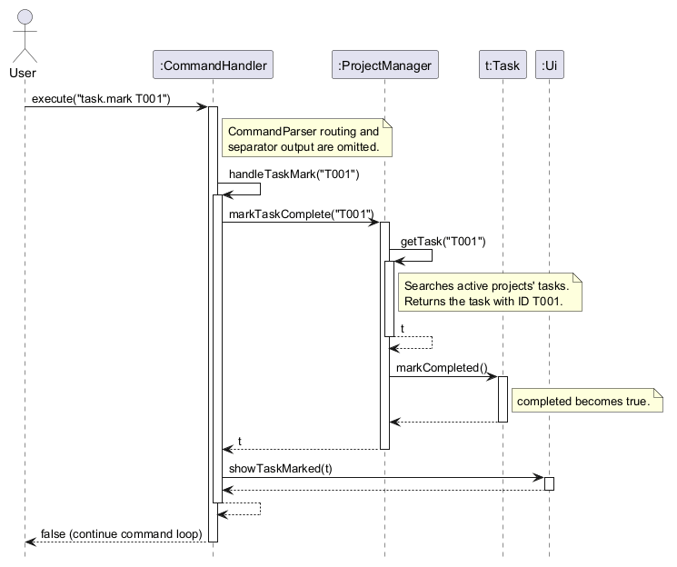
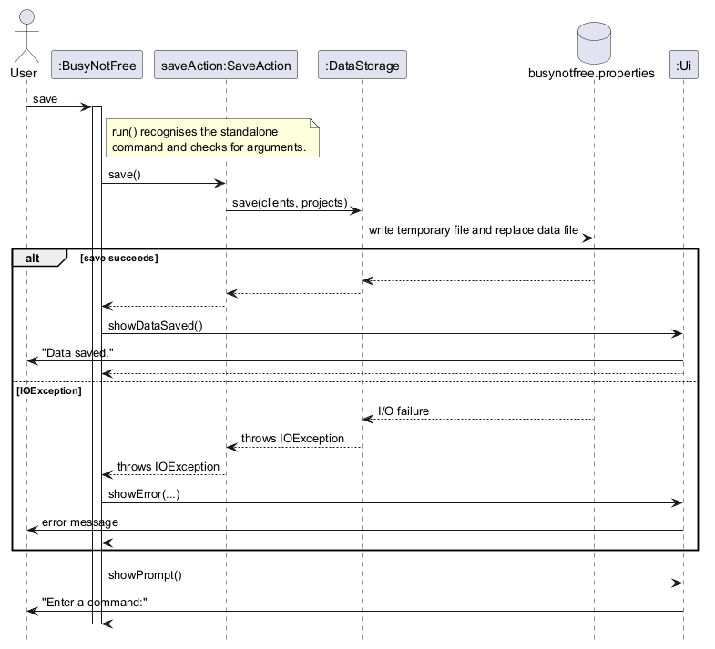
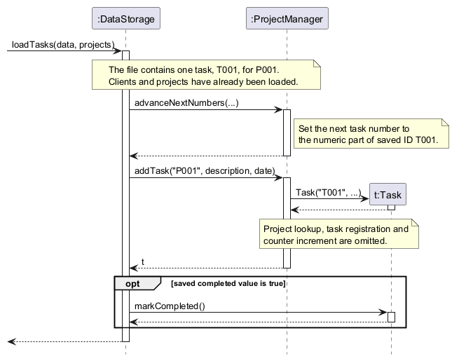
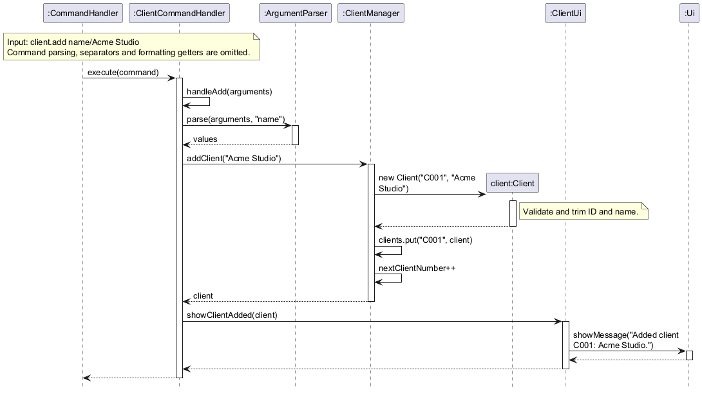
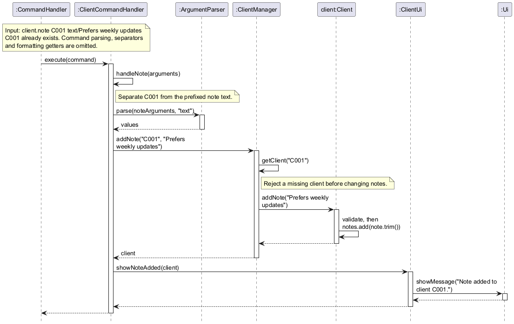

# Developer Guide

## Acknowledgements

{list here sources of all reused/adapted ideas, code, documentation, and third-party libraries -- include links to the original source as well}

## Design & implementation

{Describe the design and implementation of the product. Use UML diagrams and short code snippets where applicable.}

### Creating projects, tasks and events: `project.add`, `task.add` and `event.add`

These commands create the core records of BusyNotFree:

* `project.add client/CLIENT_ID name/PROJECT_NAME due/YYYY-MM-DD` creates a project for an existing client.
* `task.add project/PROJECT_ID name/DESCRIPTION date/YYYY-MM-DD` adds a dated internal task to an existing project.
* `event.add project/PROJECT_ID name/DESCRIPTION date/YYYY-MM-DD` adds a dated event, such as a meeting or review, to an existing project.

#### Model

The class diagram below shows the model classes involved.



* `ProjectManager` keeps every project in creation order and assigns IDs. It has a separate counter for each ID type: `P001` for projects, `T001` for tasks and `E001` for events. Task and event IDs are unique across the whole application, not just within one project, so later commands such as `task.mark T001` do not need a project ID.
* `Project` owns two separate lists, one of `Task` objects and one of `Event` objects. `getTasks()` and `getEvents()` return unmodifiable copies, so other classes cannot change a project's items without going through `Project`.
* `Task` and `Event` extend the abstract class `ScheduledItem`, which holds the fields they share: ID, owning project, description and date.
* `ProjectManager` checks that a client exists through the `ClientLookup` interface, which `ClientManager` implements.

#### Parsing the command

All three commands are parsed the same way before the model is changed:

1. `CommandParser` splits the input into a target (`project`, `task` or `event`), an action (`add`) and the remaining argument text.
2. `CommandHandler#routeCommand` sends the command to `handleProjectAdd`, `handleTaskAdd` or `handleEventAdd`.
3. The handler calls `ArgumentParser#parse` with the prefixes the command requires, for example `"project", "name", "date"` for `task.add`. It returns a map from each prefix to its trimmed value. The prefixes may appear in any order.
4. The handler calls `ArgumentParser#parseDate` to turn the date text into a `LocalDate`.

`ArgumentParser#parse` rejects a missing, blank, repeated or unexpected prefix with a `CommandException`. A prefix is recognised only at the start of the arguments or after a space. Slashes that are not recognised prefixes stay part of the value, so names such as `Create UI/UX mockup` or `Review src/main changes` are accepted as typed.

`ArgumentParser#parseDate` first checks that the text matches `YYYY-MM-DD` exactly, then parses it with `LocalDate#parse`, which rejects dates that do not exist, such as `2026-02-30`.

#### Creating a project

The sequence diagram below shows how `project.add client/C001 name/Website due/2026-11-30` is executed.



`ProjectManager#addProject` builds the `Project` using the next project ID. The `Project` constructor rejects a blank client ID or name and a missing deadline. The manager then asks its `ClientLookup` whether the client exists. Only after both checks pass does it store the project and advance the counter:

```java
public Project addProject(String clientId, String name, LocalDate deadline) {
    Project project = new Project(formatId("P", nextProjectNumber), clientId, name, deadline);
    if (!clientLookup.exists(project.getClientId())) {
        throw new ProjectException("Client " + project.getClientId()
                + " does not exist. Use client.list to see client IDs.");
    }
    projects.put(project.getProjectId(), project);
    nextProjectNumber++;
    return project; // logging omitted from this excerpt
}
```

#### Adding a task or an event

The sequence diagram below shows how `task.add project/P001 name/Wireframe date/2026-10-15` is executed. `event.add` follows the same steps, using `addEvent`, `Event`, `Project#addEvent` and the `E` ID prefix.



1. `ProjectManager#addTask` finds the project with `getProject`, which throws a `ProjectException` if the project does not exist. Missing projects are never created automatically.
2. It creates the `Task` with the next task ID. The `ScheduledItem` constructor rejects a blank description or a missing date.
3. `Project#addTask` checks that the task belongs to this project and that its ID is not already used, then adds it to the task list.
4. Only then does the manager advance the task counter. `CommandHandler` passes the new task to `Ui#showTaskAdded`.

#### Handling errors

Each layer throws its own subclass of the unchecked `BusyNotFreeException`: `CommandException` for malformed input, `ProjectException`, `TaskException` and `EventException` for invalid model data. `CommandHandler#execute` catches `BusyNotFreeException`, displays its message, and then shows the format of the failed command through `Ui#showAddCommandUsage`. The application keeps running, so the user can enter a corrected command. Unrelated programming errors are not caught, so they are not hidden.

#### Design considerations

* **IDs are only used up by successful commands.** Every check runs before a record is stored and its counter is advanced. A rejected command therefore leaves no gap in the ID sequence, and deleted IDs are never reused because the counters are saved by `DataStorage`.
* **`ProjectManager` depends on the `ClientLookup` interface, not on `ClientManager`.** Project creation could therefore be built and tested before client management was ready, using `PlaceholderClientLookup`. Tests can also supply a lambda such as `clientId -> false` to simulate a missing client.
* **A shared `ScheduledItem` superclass for tasks and events.** The common fields and checks live in one place. Each subclass passes its own exception type into the constructor as a function, for example `TaskException::new`, so a failed check throws the right exception without duplicating the checks.
  * Alternative considered: a single `Activity` class with a type field. This was rejected because tasks and events behave differently; for example, only tasks can be marked complete. Separate classes also keep the task and event sections of `project.view` simple.
* **Prefixed arguments in any order.** The trade-off is that recognised prefixes such as `name/` cannot appear after a space inside a value. Alternative considered: quoting or escaping values. This was rejected as harder to type, because descriptions that need a reserved prefix are rare.
* **Strict dates.** Impossible or loosely formatted dates are rejected instead of being corrected, so a typo cannot silently schedule work on the wrong day.
* **Logging without private text.** `ProjectManager` logs creation at the `FINE` level and includes only IDs, never client names or descriptions.

### Viewing project details: `project.view`

`project.view P001` displays one project's client, status, deadline, tasks, progress and events.
The sequence diagram follows a successful lookup; parsing of the command word and separator
output are omitted.



`CommandHandler#handleProjectView` asks `ProjectManager` for the requested project. It then
resolves the project's client ID through the shared `ClientManager` and passes both objects to
`Ui#showProjectSummary`. The handler asserts that the returned IDs match the requested project
and client IDs; these assertions check internal lookup consistency, while exceptions handle
invalid user input. `Ui` reads the task and event lists and formats them separately. Neither
viewing nor counting changes the model.

With no ID or with `all`, the handler obtains the projects in creation order from
`ProjectManager#getProjects` and prints each summary with one blank line between them. An empty
collection produces `No projects found.`. An unknown single ID produces a user-facing error
and usage hint without ending the command loop. Diagnostics at `FINE` level record the requested
ID or number of projects, not client names or task descriptions.

### Task completion, project progress and persistence

This v2.0 enhancement lets users finish or reopen tasks, see progress in `project.view`, and
retain completion state across restarts. The diagram shows where completion state lives and
which classes read or write it. Methods unrelated to this enhancement are omitted.



#### Marking and reopening tasks

`Task` owns one `completed` boolean, initially `false`. `task.mark TASK_ID` sets it to `true`;
`task.unmark TASK_ID` sets it back to `false`. The task's ID, owning project, description and
date do not change. `Task#toString` adds `[COMPLETED]` or `[In Progress]` so the state is visible
beside each task in a project summary.

The command handler requires exactly one task ID before asking `ProjectManager` to update the
task. Task IDs are unique across the application, so the user need not supply a project ID.
`ProjectManager#getTask` searches the tasks of each project, returns the matching object, or
throws `TaskException` for an unknown ID. A failed lookup leaves every task unchanged. Repeating
`task.mark` or `task.unmark` has the same result as applying it once.

The sequence diagram shows `task.mark T001`. `task.unmark` follows the same path through
`markTaskIncomplete` and `Task#markIncomplete`.



`CommandHandler#execute` catches command and model exceptions, prints the error and the
command's usage, then accepts another command. It does not catch unrelated programming errors.

#### Calculating project progress

`Ui#showProjectSummary` obtains the project's task list once. While printing each task, it
counts the ones whose `isCompleted()` value is `true`. It then prints the completed count and
the list size, for example `Progress: 1 of 2 tasks completed.`. The zero-task case prints
`No tasks found.` and `Progress: 0 of 0 tasks completed.`. Events appear in their own section
and are never part of the task count. For `project.view all`, each summary calculates its own
count, so progress from one project cannot affect another.

The count is derived when a summary is displayed instead of being stored in `Project`. This
avoids a second value that could become stale when a task is marked, reopened or deleted.

#### Saving during a session or on exit

`save` lets a user persist current data without ending the session. `BusyNotFree#run` recognises
this standalone command before sending dotted commands to `CommandHandler`. It rejects extra
arguments, calls `saveData`, shows `Data saved.` only if the write succeeds, then prompts for
another command. File I/O stays in the application layer, where the existing save action is
already available. The sequence diagram shows the success and I/O failure paths.



In `BusyNotFree#main`, the `SaveAction` callback is connected to
`DataStorage#save(clientManager, projectManager)`. Both `save` and `exit` use `saveData`, which
reports an `IOException` and returns `false` on failure. The `exit` path additionally shows
`Data saved. Goodbye!` and leaves the command loop only after a successful write. A failed
explicit `exit` can be retried, while a failed `save` simply returns to the next prompt.
`SaveAction` lets tests simulate failed writes without accessing the real filesystem.

The following diagram shows how an `exit` save stores task completion and how startup restores
it. The standalone `save` command calls the same `DataStorage#save` method.



`DataStorage#save` gathers tasks from every project, sorts them by their application-wide IDs,
and writes each flag alongside the task's existing fields in the version 1 properties file.
For example, `task.0.completed=true` records a completed task. It writes a temporary UTF-8
file in the data directory before replacing the old file. An atomic replacement is attempted
first, with an ordinary replacement when the filesystem does not support atomic moves.

On the next launch, `DataStorage#load` creates linked client and project managers, restores
clients and projects first, then reconstructs tasks and events. Once each task exists, a saved
`true` flag marks it complete. A missing flag defaults to `false`, so data files produced before
this enhancement still load with their tasks in progress. Only the exact values `true` and
`false` are accepted; an invalid value makes loading fail instead of silently changing a task's
state. Saved next-ID counters also prevent deleted IDs from being reused after a restart.

Marking and reopening change only the in-memory model. The next successful `save` or `exit`
writes the new state. `BusyNotFree#main` reports a load error and stops if a saved file is
invalid. On end-of-input, the command loop attempts a save once before returning; an explicit
`save` or `exit` can be retried after a failed write.

#### Design and verification

* A boolean is sufficient because a task has only two completion states. An enum would be more
  useful if additional workflow states were introduced later.
* One properties file keeps task state with its project and client data. Adding an optional
  field avoids changing the file version or rejecting existing v1.0 saves.
* The application handles `save` because it is a standalone command that needs storage access.
  This avoids giving the general `CommandHandler` responsibility for file I/O.
* [`CommandHandlerTest`](../src/test/java/busynotfree/command/CommandHandlerTest.java)
  covers marking, reopening and invalid IDs. [`ProjectViewTest`](../src/test/java/busynotfree/command/ProjectViewTest.java)
  checks empty, partial and complete counts, including `project.view all`.
  [`DataStorageTest`](../src/test/java/busynotfree/storage/DataStorageTest.java) checks
  saved and restored flags, the older-file default and malformed saved data.
  [`BusyNotFreeTest`](../src/test/java/busynotfree/BusyNotFreeTest.java) checks `save` success,
  failure and continued input. [`BusyNotFreeClientTest`](../src/test/java/busynotfree/BusyNotFreeClientTest.java)
  checks that an in-session save can be loaded before a later exit.

### Editing tasks and events: `task.edit` and `event.edit`

`task.edit TASK_ID name/DESCRIPTION date/YYYY-MM-DD` and `event.edit EVENT_ID name/DESCRIPTION date/YYYY-MM-DD` replace the description and date of an existing task or event. Both commands share one implementation path:

1. `CommandHandler#routeCommand` sends `task.edit` to `handleTaskEdit` and `event.edit` to `handleEventEdit`.
2. Both handlers call `parseEditArguments`. It takes the first word as the item ID, then uses `ArgumentParser` to read the required `name/` and `date/` arguments, and `ArgumentParser#parseDate` to check the date. The result is held in a private `EditArguments` record.
3. The handler calls `ProjectManager#editTask` or `ProjectManager#editEvent`. The manager finds the item by its application-wide ID with `getTask` or `getEvent`, searching every project.
4. The manager calls the package-private `Task#edit` or `Event#edit`. Both delegate to `ScheduledItem#updateDetails`, passing in their own exception type.
5. `updateDetails` checks the new description and date with the same `validateDetails` helper used by the constructor, and only then assigns both fields.
6. `Ui#showTaskEdited` or `Ui#showEventEdited` displays the updated item using its `toString()`, so a task also shows its completion state.

```java
protected final void updateDetails(String description, LocalDate date,
        Function<String, ? extends BusyNotFreeException> exceptionFactory) {
    validateDetails(description, date, exceptionFactory);
    this.description = description.trim();
    this.date = date;
}
```

**Design considerations**

* **An invalid edit leaves the item unchanged.** Every check happens before any field is assigned: the command format and date are checked in `CommandHandler`, the ID in `ProjectManager`, and blank values in `ScheduledItem`. Description and date are assigned together, so an edit never applies half of its changes.
* **ID and project cannot change.** `ScheduledItem` keeps `id` and `project` as `final` fields and makes only `description` and `date` editable. `parseEditArguments` accepts only `name/` and `date/`, so `project/` is rejected as an unexpected prefix. Editing does not create an item, so ID counters are not advanced.
* **Completion status is preserved.** `Task#edit` changes only the fields inherited from `ScheduledItem`; it never touches `completed`.
* **Edits go through `ProjectManager`.** `edit` is package-private, like `Project#removeAllActivities`, so other packages cannot change an item without the manager's ID lookup.
* **Alternative considered: replacing the item.** A new `Task` or `Event` could replace the old one in its project's list. This would need extra code to copy the completion state and keep the item's position in the list, so editing the existing object was chosen as the simpler option.
* **Storage needs no change.** `DataStorage` already saves each item's current description and date, so edited values survive a restart.


### Managing clients: `client.add`, `client.note`, `client.view` and `client.list`

Client management lets freelancers register clients and keep notes about their preferences or requirements. The four commands are:

* `client.add name/CLIENT_NAME` registers a client and displays the assigned ID.
* `client.note CLIENT_ID text/NOTE` appends a note to an existing client.
* `client.view CLIENT_ID` displays a client's ID, name and all recorded notes.
* `client.list` displays every client's ID and name in creation order.

For example, `client.add name/Acme Studio` can create `C001`, after which `client.note C001 text/Prefers weekly updates` records a preference for that client. IDs are case-sensitive; two clients may have the same name but receive different IDs.

#### Responsibilities and integration

* `CommandHandler` parses the command through `CommandParser` and delegates commands whose entity type is `client` to `ClientCommandHandler`. It also handles errors through the shared `Ui`.
* `ClientCommandHandler` selects the client operation, validates its argument structure and calls `ClientManager`. It reuses `ArgumentParser` for the `name/` and `text/` arguments.
* `ClientManager` owns a `LinkedHashMap<String, Client>` and the next client number. It creates clients, looks them up by ID and directs notes to their owner. The map preserves creation order while supporting ID lookup without scanning every client.
* `Client` holds an immutable ID and name, and an append-only list of notes. Its constructor and `addNote` method reject null or blank values and trim surrounding whitespace.
* `ClientUi` formats client responses and sends them through the shared `Ui#showMessage`, keeping output formatting separate from command parsing and model changes.

`ClientManager` implements `ClientLookup`, allowing `ProjectManager` to check whether a client exists without depending on client command handling. The application uses the same client manager for command handling and project lookup, so a newly registered client can immediately be used by `project.add`. Callers that need this integration should use the four-argument `CommandHandler` constructor with the shared manager; the three-argument constructor creates an independent client manager.

#### Registering a client

The sequence diagram below shows the successful execution of `client.add name/Acme Studio`, assuming the next available client ID is `C001`. It starts after `CommandParser` has parsed the input; separator output and read-only getter calls used for formatting are omitted.



1. `CommandHandler#routeCommand` delegates the parsed command to `ClientCommandHandler#execute`, which selects `handleAdd`.
2. `ArgumentParser#parse(arguments, "name")` requires exactly one non-blank `name/` value. Parsing finishes before the manager is called, so a malformed command cannot allocate an ID.
3. `ClientManager#addClient` formats the next number as an ID with the `C` prefix and at least three digits, then constructs a `Client` with that ID and the supplied name.
4. Only after construction succeeds does the manager put the client in its map and increment `nextClientNumber`. A rejected name therefore leaves both the collection and counter unchanged.
5. `ClientUi#showClientAdded` displays the assigned ID and name, for example `Added client C001: Acme Studio.`.

The three-digit padding is a minimum width, so the sequence continues from `C999` to `C1000`. Client names are not map keys, allowing separate clients with identical names.

#### Recording a client note

The sequence diagram below shows `client.note C001 text/Prefers weekly updates`, assuming `C001` already exists. As above, command parsing, separators and formatting getters are omitted.



1. `ClientCommandHandler#handleNote` separates the first word, the positional client ID, from the remaining prefixed arguments. A missing ID, or a prefix supplied in its place, is rejected.
2. `ArgumentParser#parse(noteArguments, "text")` checks that a non-blank note is supplied exactly once.
3. `ClientManager#addNote` calls `getClient` before attempting the update. A missing client raises `ClientException`; it never creates a client automatically.
4. `Client#addNote` validates and trims the text, then appends it to the existing notes. Earlier notes and other clients are unchanged.
5. `ClientUi#showNoteAdded` confirms the update with `Note added to client C001.`.

Names and notes preserve internal spaces and ordinary slash-containing text such as `UI/UX` or URLs. Recognised argument prefixes at whitespace boundaries remain reserved: for example, `name/` inside a note is treated as an unexpected argument, and a second `text/` is rejected as a repeated prefix. Quoting or escaping reserved prefixes is not supported.

#### Viewing and listing clients

`client.view` requires exactly one positional ID. The handler calls `ClientManager#getClient`, then `ClientUi#showClient` prints the ID and name followed by each note in insertion order. A client without notes displays `Notes: No notes found.`. Leading and trailing whitespace around an ID is trimmed, but its case and digits must match an existing ID.

`client.list` calls `ClientManager#getClients`, which returns `List.copyOf(clients.values())`. `ClientUi#showClients` prints numbered entries in creation order, or `No clients found.` when the collection is empty. Listing omits notes; users can request them through `client.view`. Extra arguments to `client.list` are ignored, matching the application's convention for commands without parameters.

Both `getClients()` and `Client#getNotes()` return unmodifiable snapshots of their collections. Callers cannot add or remove entries through these lists. The client snapshot still contains references to the existing `Client` objects; it is not a deep copy of their state.

#### Validation and error handling

Malformed command arguments raise `CommandException`; invalid client data or an unsuccessful client lookup raises `ClientException`. Both extend `BusyNotFreeException`, which `CommandHandler#execute` catches. It displays the error and, for a supported client action, asks `ClientCommandHandler#showCommandUsage` to display the expected format. The command loop remains available for corrected input. An unsupported client action produces an error without a usage hint.

Assertions check internal assumptions: only client commands reach `ClientCommandHandler`, the next client number is positive, a generated ID cannot replace an existing client, and a successful lookup returns the requested ID. These checks help detect programming errors when assertions are enabled; exceptions still validate user input when assertions are disabled.

#### Design considerations

* **Separate client command handling.** `ClientCommandHandler` and `ClientUi` keep client-specific parsing and formatting together while reusing the shared router, parser and output interface. An alternative would be to place every client action in `CommandHandler`; the separate handler limits the growth of that shared class.
* **IDs identify clients instead of names.** Sequential IDs provide a stable reference for notes and projects even when names are duplicated. Using names as keys would require rejecting duplicates or introducing rules to distinguish them.
* **A map preserves both lookup and display order.** `LinkedHashMap` supports lookup by ID and predictable listing. An `ArrayList` would preserve creation order but require a search for each ID; an ordinary `HashMap` would not guarantee creation order.
* **Notes belong to their client.** An ordered list of strings is sufficient for appending and displaying notes. Separate note objects with their own IDs could support editing or deleting individual notes, but those operations are outside the current client commands.
* **Validate before changing state.** Parsing precedes manager calls, client construction precedes registration and counter advancement, and note validation precedes insertion. Invalid operations therefore leave existing client data unchanged.
* **Persistence is handled separately.** Client commands update the in-memory model. The application's `DataStorage` integration saves clients, notes and the next client number with the project data on `save` or `exit` and restores them at startup. The client handler does not perform file I/O or save after each command.

#### Existing verification

[`ClientTest`](../src/test/java/busynotfree/model/ClientTest.java) and [`ClientManagerTest`](../src/test/java/busynotfree/model/ClientManagerTest.java) cover validation, duplicate names, ID allocation beyond `C999`, note ownership, collection snapshots and real client lookup during project creation. [`ClientCommandHandlerTest`](../src/test/java/busynotfree/command/ClientCommandHandlerTest.java) covers all four commands through the shared router, including malformed input, missing clients, output order and recovery after errors. [`ClientArgumentParserTest`](../src/test/java/busynotfree/command/ClientArgumentParserTest.java) covers free text and reserved prefixes. The repeatable console acceptance scenario is documented in the [UI test plan](../test/ui-test-plan.md).

### Trashcan responsibilities and shared wiring

`TrashcanManager` owns deleted client and project snapshots. Both deletion paths
store independent copies before clearing active data. Returned trashcan lists also
contain copies, so callers cannot modify the stored snapshots.

`TrashcanCommandHandler` handles `trashcan.list`, `trashcan.restore`, argument
validation and usage hints. `CommandHandler` delegates these commands and retains
the shared error-reporting boundary. Display formatting continues through `Ui`.

Project restoration calls `ProjectManager#registerRestoredProject` to validate the
active client and check ID conflicts. Only successful registration removes the
trash entry. Existing manager methods delegate to the shared trashcan, preserving
storage imports, ID-counter validation and existing callers.

`DataStorage#load` explicitly creates one `TrashcanManager` and supplies it to
`ClientManager` and `ProjectManager`. The command handler uses that same instance.
The convenience constructor `ProjectManager(ClientLookup)` also reuses the
trashcan when its lookup is a `ClientManager`. File fields and command output
remain unchanged by this separation of responsibilities.

## Product scope
### Target user profile

{Describe the target user profile}

### Value proposition

{Describe the value proposition: what problem does it solve?}

## User Stories

|Version| As a ... | I want to ... | So that I can ...|
|--------|----------|---------------|------------------|
|v1.0|new user|see usage instructions|refer to them when I forget how to use the application|
|v1.0|freelancer|create a project for an existing client with a deadline|organise and plan the client's work|
|v1.0|freelancer|add a dated internal task to a project|track the work that needs to be completed|
|v1.0|freelancer|add a scheduled event to a project|keep track of meetings, reviews and presentations|
|v1.0|freelancer|view one or all project summaries|check clients, deadlines, tasks and events together|
|v1.0|freelancer|save my work when I exit|continue from the same data on the next run|
|v2.0|freelancer|mark a task complete or reopen it|keep its status aligned with the work left to do|
|v2.0|freelancer|see a completed-task count for each project|assess progress at a glance|
|v2.0|freelancer|retain task completion after restarting|avoid marking the same tasks again|
|v2.0|freelancer|save my work without exiting|protect recent changes during a long session|
|v2.0|user|find a to-do item by name|locate a to-do without having to go through the entire list|
|v2.0|freelancer responding to changes in client requirements|edit an existing task's description and date without changing its ID or project|keep the work plan accurate|
|v2.0|freelance consultant arranging client meetings|edit an existing event's description and date without changing its ID or project|update a rescheduled meeting without deleting and recreating it|

## Non-Functional Requirements

{Give non-functional requirements}

## Glossary

* *glossary item* - Definition

## Instructions for manual testing

{Give instructions on how to do a manual product testing e.g., how to load sample data to be used for testing}
